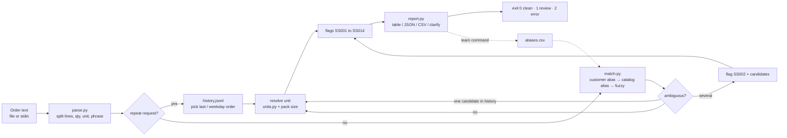

# Architecture

## App flow



## System architecture

A single-process Python CLI. No network, no database, no background service. All state is in three plain files the user owns:

| File | Role |
|---|---|
| `catalog.csv` | The seller's catalog: `sku,name,unit[,pack_size,pack_unit,aliases,in_stock]` |
| `aliases.csv` | Learned phrases: `customer,phrase,sku` (`*` = every customer) |
| `history.jsonl` | Confirmed past orders, one JSON object per line |

The pipeline is pure functions (`parse_order` → `match_lines` → renderers), so it is easy to test and to embed in another program.

## Folder and file structure

```
sku-snap/
├── src/skusnap/
│   ├── __init__.py      # version
│   ├── __main__.py      # python -m skusnap
│   ├── cli.py           # argparse: match, learn, rules; exit codes
│   ├── parse.py         # message → ParsedLine (qty, unit, phrase, repeat)
│   ├── units.py         # unit vocabulary + exact conversions
│   ├── catalog.py       # CSV / JSONL loaders, InputError, append_alias
│   ├── match.py         # scoring, ambiguity, unit fitting, RULES
│   └── report.py        # table, JSON, CSV, clarification draft
├── tests/               # pytest: parser, matcher, CLI contract
├── examples/            # catalog.csv, aliases.csv, history.jsonl, orders/*.txt
├── skills/sku-snap/SKILL.md   # Agent Skill for Claude
├── docs/media/          # launch video, cover
├── .github/workflows/ci.yml
└── PRD.md Architecture.md Rules.md Phases.md Design.md Memory.md
```

## Tech stack

| Choice | Why |
|---|---|
| Python 3.10+ | Runs anywhere a rep's laptop does; same language as most data tooling. |
| Standard library only (`csv`, `json`, `difflib`, `unicodedata`, `argparse`) | `pip install` in seconds, nothing to audit, works offline. |
| `difflib.SequenceMatcher` + token scoring | Good enough for shorthand and typos, deterministic, explainable scores. |
| pytest (dev only) | Fast tests, parametrised parser cases. |
| GitHub Actions | Runs the tests on 3.10 and 3.12. |

## Data model

```text
ParsedLine  line_no, raw, qty?, unit?, phrase, repeat?        (parse.py)
Item        sku, name, unit, pack_size?, pack_unit?, aliases[], in_stock   (catalog.py)
Line        line_no, raw, qty?, unit?, sku?, name?, score, source,
            candidates[{sku,name,score}], flags[Flag]          (match.py)
Flag        id (SS001..SS014), message, level (info|review)
```

`source` is one of `customer-alias`, `catalog-alias`, `fuzzy`, `history`, `none`.

### Matching score

For a phrase `q` and a catalog name or alias `c` (both tokenised, stopwords and digits dropped, plurals trimmed):

```
score = 0.60 · coverage(q in c) + 0.15 · precision(c in q) + 0.25 · sequence_ratio
```

Token similarity is 1.0 for equal tokens, 0.9 when `c` starts with a 3+ letter `q` (shorthand), the `difflib` ratio when ≥ 0.8 (typos), else 0. Thresholds: confident ≥ 0.72 (`--min-score`), candidate ≥ 0.5, ambiguity margin 0.06, chatter (no quantity) < 0.6.

## Key APIs / integrations

- **CLI contract**: `sku-snap match ORDER --catalog CSV [--customer ID --aliases CSV --history JSONL] [--format table|json|csv] [--out FILE] [--clarify] [--min-score N]`.
- **JSON output**: `{tool, version, customer, status, summary{lines,ok,review,ignored}, lines[...], ignored[...]}`.
- **CSV output**: `line_no,sku,qty,unit,name,status,flags,raw`, ready to map into an ERP import.
- **Python API**: `parse_order(text)`, `match_lines(parsed, catalog, aliases, history)`, `to_json(...)`.
- **Agent Skill**: `skills/sku-snap/SKILL.md` lets Claude run the CLI and explain results.
- No ERP API integrations in v0.1 (roadmap).
